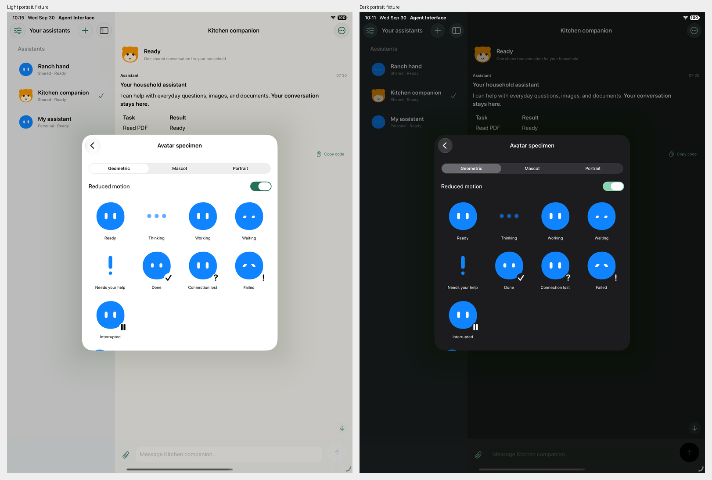
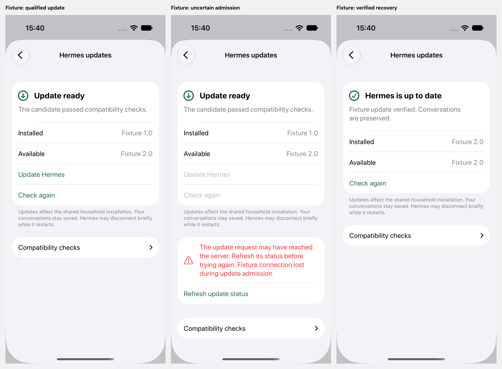

# Native parity and acceptance

The native implementation uses the web client's settled scope in
[`docs/Plan.md`](../docs/Plan.md) and the same server endpoints. "Implemented"
means the native control and authenticated request path exist. The validation
ledger remains the repository's single source for tested code-state hashes.

The October 16 parity update aligns home, account Settings, conversation turns,
the composer, model selection, artifacts and Today with the web client. Device
permissions use iOS. The October 17 follow-up matches the web's composer and
header controls, working sentence and tool props, connection card, relative
timestamps, Today summary, view subtitles, search and group chat copy, Settings
sections, collapsed assistant model row, memory, routine cards and reply cards.
Group chats keep native list-to-detail navigation. The second October 17
follow-up fixes the transcript's scroll and loading, then closes the remaining
gaps a full side-by-side audit found in rendering, the composer, settings,
launch and connection states, notifications, group chats, search and Today.
Current results and code-state fingerprints are recorded in
[the validation ledger](../docs/ValidationLedger.md).

The [phone comparison](evidence/mobile-parity-phone.png) and
[iPad comparison](evidence/mobile-parity-ipad.png) show synthetic fixture content
in light and dark appearance. They establish native layout and controls.
Earlier real-Hermes checks cover system-browser sign-in, Keychain storage,
canonical chat, the tool catalog and avatar settings against an isolated server.

These screenshots show static reduced-motion states. They do not establish live
motion fidelity or notification delivery.

These upgrade screenshots establish native controls and recovery behavior with
fixture responses. They do not establish a real Hermes upgrade. The
[native activity fixture](evidence/native-live-activity-fixture.png) shows visible
working avatars and Advanced disclosures using explicitly exposed fixture data.

| Feature | Native implementation | Validation |
| --- | --- | --- |
| Agent messages | Incoming native envelope, agent-origin messages and outgoing `message_agent` handoff render as the exchange card, in activity groups and saved history, and remain visible in Simple mode; attributed household messages retain their sender | Swift envelope, sender and visible-history regressions; web envelope tests |
| Composer model and inference | Advanced presentation opens the same searchable Hermes catalog used by assistant settings, with provider groups, warnings, unavailable selections, refresh and account model favorites. Reasoning and Normal/Fast/Ultrafast speed use the conversation inference endpoint. Shared model changes retain Hermes confirmation. | Native protocol and fixture checks are recorded in the current validation ledger. Signed-device use against a real provider remains external acceptance |
| Routine results | Saved run picker and output, with "Loading output…" while it loads, in settings and Today; routine push links open the results sheet | Native decoding and phone fixture flow; real native profile-scoped output probe and server access checks in the main ledger |
| Group chats | Local 2–6 member room creation that opens the new room, a "Finish creating group" row for a saved create, a catalog refreshed every 15 seconds, 100 and 16,000 character input limits, authors matched by actor or member ID, thread replies, persistent send retry, polled native messages/status, approval and stop controls; coordinator availability gates sending; a group with your personal assistant says only you will see it, and a group that disappears stops polling and clears its name, members and messages | Native protocol decoding and phone creation/send fixture flow; real native coordinator admission, deduplication, log and stop probe in the main ledger |
| Today overview | Errors add "Loaded results may be out of date." and background polls neither clear them nor disable Refresh. Recent canonical events and date-filtered replies, pending decisions, live status and files, per-assistant read failure, canonical conversation links, explicit account-level Mark caught up acknowledges the exact returned ingestion frontier, with page-by-page catch-up for queued results | Native recency tests reject old and undated summaries; phone and iPad fixture UI exercised recent event/reply and conversation navigation; affected native unit and phone UI checks verified exact snapshot acknowledgment, queued pages, and late imported events dated before the prior recap marker |
| Hermes memory | Exact Hermes profile scope and ownership labels, entry editing and forgetting with explicit document save, revision conflicts preserved across unsaved documents | Native cross-document CAS regression; phone and iPad fixture read, forget and save flow; production writes require the qualified Hermes add-on |
| Passwords and logins | Native Hermes profile vault metadata, masked add form, confirmed local removal, installed external source controls; the web's copy and bad-address message; a 5xx or transport failure locks every vault action until a reload succeeds, while a definite 4xx rejection shows its reason without locking; the unlock sheet stays open with its own error; inline login, code, unlock and named-secret requests bound to the current native owner; ephemeral fields clear on submit/background/dismissal, uncertain requests become read-only with explicit refresh | Ten focused unit checks; phone and iPad fixture management, secure request and background clearing flows; final uncertainty checks on both devices assert disabled fields and no replay. Real native storage and browser guards are recorded separately in the main ledger |
| Voice messages and replies | Explicit microphone permission, two-minute AAC recording, authenticated 8 MB transcription bound, inline controls that transcribe when recording stops and add the text to the draft on a new line, as on the web; the draft remains unsent and recording stops on dismissal/background. Listen to reply plays the server's `/voice/speak` audio with the configured provider, refuses replies over 12,000 characters with the web's message, is unavailable while sending, pending or disconnected, and has Stop. Ogg and WebM speech cannot play on iOS and says so | Native multipart/authentication/bound tests and server speech, long-reply refusal and transcript separator contract tests; phone fixture flows transcribe into the draft and play server audio with Stop; real microphone audio, provider transcription and audible playback remain external acceptance |
| Interactive reply cards | Opt-in editable assistant instructions; strict agent-ui v1 cards, in scheduled replies as well; inline UI stays assistant-only; per-account saved checklist choices and itinerary notes; rejected blocks remain readable code; calendar proposals open Apple's event editor for review and explicit Save | Native invalid URL/date/schema/duplicate-ID parsing tests; phone and iPad saved checklist UI; physical calendar Save remains external acceptance |
| Connection onboarding | A saved sign-in launches into "Connecting to your household…", or during an outage "Can't reach the app right now. We'll keep trying." with Try again and Change server, never the sign-in controls. Disconnected with no assistants, home and the detail pane show the web's Hermes setup panel; offline copy disables Reconnect. Pasted/bare HTTPS address, origin normalization, compatibility check, Retry connection that also runs when the app returns to the foreground, change server that still works when the server is unreachable (clears the local token and warns the server-side session stays valid until it expires). A saved sign-in opens without `/auth/config`, which sign-in fetches when needed | Simulator address validation; native origin/PKCE contract tests; native tests for outage then recovery at launch and for offline change server |
| Household sign-in | System browser handoff, S256 PKCE and callback state validation, Keychain bearer, proactive expiry, revoking sign-out. Only a 401 with the server's `session_expired` code signs the person out; other 401s are ordinary errors | Real ad hoc signed simulator system-browser/local-member handoff and Keychain storage; native token/header/expiry/revocation tests; native tests that only the `session_expired` code clears the Keychain token |
| Personal and shared bots | Persistent roster, attribution, per-user personalization, create/edit/delete; confirmation before an assistant everyone sees becomes personal; an open assistant that stops being available returns home with a short message and stops polling | Native forms and roster-to-conversation simulator path; unit checks for the confirmation rule and leaving a missing assistant; server configuration integration in main ledger |
| Conversation and activity | Opens at the latest message like the web, pages in 20 earlier turns near the top while holding the reader's place, follows new replies only at the end, and offers Jump to latest with a new-message count. Change notices from the conversation event stream drive updates, with a 30-second poll while the stream is live and the 1.5-second poll without one. VoiceOver reads each settled reply once, by the web's announcement rules. Canonical transcript; a person's text is plain and assistant and scheduled replies render GFM Markdown as the web does (nested lists, quotes, rules, headings, any fence with its language and Copy code, autolinks, images as links, soft breaks, skipped HTML, renumbered lists, aligned tables); read-only task lists; inline live animated avatar, Advanced exposed reasoning as plain parts with a count, tool calls with Call, Started, Finished and preformatted Arguments, Result and Error plus the web's waiting copy, plain approval and request details, deduplicated current calls, nine activity states | Native real-Hermes chat simulator path; Markdown/date/geometry and current-tool deduplication tests; focused live activity/details fixture UI pass; long-history open, paging and jump UI test; stream cadence and announcement unit tests; server bearer stream test |
| Steering and stop | Active-work guidance default, explicit stop confirmation | Same tested server admission/steering/stop routes; native controls implemented |
| Approvals and clarification | Household approve/deny, stale-server errors, answer options and text, official-interface fallback | Native controls implemented; server enforcement and clarification integration in main ledger |
| Interrupted/uncertain work | One unconfirmed send per assistant, as on the web, migrated from the earlier single slot; HTTP 408 counts as a rejection. Per-run review, durable request IDs, lookup, reviewed same-ID retry, definitive-rejection recovery. An unconfirmed send can always be discarded: its text and attachments return to that assistant's draft, with a warning that the message may still arrive. As on the web, a sent message shows in the transcript at once while Send keeps spinning: faint and marked Sending…, Not confirmed yet once the request ends without a receipt, then as an ordinary message until Hermes's own copy takes its place. It rises in unless Reduce Motion is on. The composer empties for the next message and blocks attaching while the request is in flight; a refused send goes back in front of anything typed meanwhile | Native unit tests for rejection vs uncertainty, new interruptions, identity changes, accepted-draft clearing, and discarding into the same, an edited, an emptied and another assistant's draft; sent-echo transition, anchor and account-change tests mirroring the web's, and store tests for the emptied composer and a refused send restored in front of typed text |
| Offline recovery | Loaded roster/transcript cache in memory, scoped local drafts, reading positions saved to the server as on the web, backoff, manual reconnect, no automatic message replay. Drafts save on their base revision and merge by the shared rule in the native API contract; a pending edit saves at once on assistant switch or backgrounding | Native disconnect, canonical-read outage, latest-page open and identity-race tests; draft merge unit tests and stale-sent, switch and background flush, concurrent edit, typed-after-send, send-before-save and recovered-draft revision tests |
| Uploads and delivery | The web's file rules (images, PDFs and any text type), ten attachments, 20 MB bound; per-file progress, Finishing and Didn't upload states with one dismissible notice for refused files; queued files resume when the connection returns; Photo Library, Take Photo, Choose Files, image paste and drag and drop; hardware Return sends and Shift-Return adds a line; the 50,000 limit counts UTF-16 units like the server; authenticated image/Quick Look preview and share; externally hosted files open at their source | Native multipart transport and identity-race tests; server upload/download integration in main ledger |
| Model/provider/instructions/MCP | Shared-model confirmation, existing model choices/identifiers, instructions, existing MCP identifiers | Native forms implemented; server configuration integration in main ledger |
| Tools and skills | Catalog reads, required-skill locking, explicit save, save disabled until successful catalog read, retry | Native catalog-failure simulator test; real-Hermes native tool-catalog read; server catalog integration in main ledger |
| Routines | Create/edit/delete/pause/resume, server-provided recipes starting paused, Hermes timezone and next-run preview, successful matching preview required before saving an enabled routine, explicit recipients; single-tap Try once with a durable request ID, uncertain receipt check and reviewed same-ID retry, completed runs allow a new trial | Native receipt decode; phone and iPad preset/timezone UI; phone and iPad uncertainty recovery verified a fresh request ID for a completed second trial; server execution integration in main ledger |
| Three avatar modes | All 20 original geometric silhouettes with their face anchors, palette/custom color, eyes/spacing/size, accessories, sprout/fox/bear mascot with ears, muzzle and glossy eyes, generated/uploaded portrait with a per-state ring | Native shape geometry tests and a web check that native paths and anchors match; specimen state matrix of eight characters across all nine states |
| Avatar editor | Live preview with state chips, segmented style that keeps color, eyes, accessory and eye tuning across styles, mini-avatar tiles for shape, character (seasonal characters under their own heading), eyes and accessory, swatches and custom color, eye sliders with percentages and Reset eyes | Simulator screenshot tour |
| Avatar motion | Ported from `src/components/avatar-motion.ts` with the same constants: 280 ms shape morph, expression smoothing (0.09 s) and symbol morph (0.13 s), arrival boop, blink and gaze wander, sphere-projected face that hides far-side features, working scan and spin with trails that wrap behind and in front of the body, trail carry-over between states, two-turn done celebration that settles into happy eyes, failed shake, thinking dots, blocked exclamation. Connection lost and interrupted never move. Badges only for done, failed, connection lost and interrupted; portraits badge every state except ready, thinking and working. Web-only so far: held tool props while working | Native motion tests mirror `tests/avatar-motion.test.ts`; native specimen inspection remains recorded separately from web reference acceptance |
| Reduced motion and accessibility | System reduced motion halts loops/rotation/trails, the assistant list states each non-idle activity in words, stable state language, native Dynamic Type and controls, labelled actions | Native specimen toggle; physical VoiceOver and large Dynamic Type acceptance remains external |
| Settings and home | Account menu, pinned avatars in saved order, message previews and dates, pin actions in the header and context menu, home sections, account/connection links, Appearance, Advanced details, start page, delivery rules and following. Settings writes changes in order and exposes retry on failure. Assistant settings clear notices on tab change and show per-button Saving… and Saved; the model picker shows favorites' providers and gates Refresh and stars as the web does; home timestamps share one minute tick. | Native unit and phone/tablet fixture checks in the current ledger |
| Shared computer | Settings shows whether the desktop is available and who has control, then opens the configured app server's `/?computer=1` in the system browser for the shared desktop and VPS terminal; browser sign-in stays separate from the native token | Native link uses the existing same-origin URL builder; rendered interaction validation recorded in the main ledger |
| Hermes updates | Settings entry, installed/candidate versions, the web's check-versus-install wording, Find / Test in a copy / Install steps, unconfirmed Stop checking, retry and cancel for installs only, test details opened when stopped, check and compatibility details, confirmed pinned-revision install, progress polling, guarded restart/retry/cancel recovery from server action availability, safe-boundary guidance, uncertain recovery without replay, rollback/failure guidance, busy-bot/admin/unavailable guidance; shared server bearer authorization | Native contract tests for authenticated requests, stale candidates, stale recovery operation IDs, uncertain install/control recovery and identity fences; focused phone fixture UI covered guarded restart recovery in addition to qualification, uncertain admission, progress and verification |
| Integration accounts | Settings and per-assistant Connections view with the connected count, Refresh status and the web's copy; checked/configured/expired/permission/outage states, safe account identity and access details, Connect/Reconnect/Disconnect, setup fields, custom MCP and browser sign-in with durable flow polling | Native build and explicit simulator fixture account check and disconnect; real provider sign-in remains external acceptance |
| Apple Calendar and Reminders | EventKit full-access permission requested explicitly, selected calendars/lists and bounded date window, sanitized preview, refresh, explicit upload into the chosen assistant draft; user sends it from the conversation | Native upload/draft-preservation contract test and simulator permission status/selection view; physical-device permission and real account data sharing remain external acceptance |
| Native notifications | The web's one-time "Enable notifications on this device?" card; iOS permission is requested only after Enable, "Not now" is remembered per account, and Settings has a switch that registers or unregisters this device with the server, with retry on failure; foreground registration reconciliation, server unregister on OS denial, task/routine/follow recipients, validated cold/warm conversation tap; chat presence heartbeats as on the web, paused while a sheet covers the chat, no banner for the chat on screen, and delivered notifications cleared when their chat opens here or a background clear push arrives | Native route tests and simulated server delivery tests; signed physical-phone delivery remains external |
| Live Activity | One aggregate activity per device from the server's state: Lock Screen header and up to four rows with live elapsed timers, Dynamic Island compact, minimal and expanded views tinted by the first row, out-of-date rendering after the 15-minute stale date. Starts in the foreground after an accepted send with a local `starting` row, or on foreground when the state has active rows; registers each push token, re-registers on foreground, ends extra and other-account activities, unregisters when the activity ends, and follows iOS Live Activities authorization | Unit tests decode the documented state and the server fixture, including unknown phases and epoch seconds, and cover hero labels, stale rows and seeding. Views rendered to PNG in light and dark. Not established: ActivityKit start and APNs push updates, which need a signed physical device with the push entitlement |
| Widgets | One Assistants widget in small, medium, large and Lock Screen rectangular, circular and inline sizes. Reads only an App Group snapshot of names, states, avatar colors, favorites and privacy-sensitive message previews; no sign-in token. Shows its time, says "Open WildBots to refresh" after 30 minutes, and opens `agentinterface://open?bot=ID` | Unit tests cover ordering, staleness, the reload rule, sign-out removal and deep link mapping. Views rendered to PNG in light, dark and vibrant. Home Screen placement and redaction on a locked device remain physical-device acceptance |
| App updates | A banner above the main UI and a Settings About row open the server's HTTPS update link when this build is older than `nativeApp.latestBuild` | Unit tests for behind, equal, ahead, missing and non-HTTPS links; phone fixture UI asserts the banner and both Update buttons without opening the link |
| iPad | Adaptive native NavigationSplitView, readable-width transcript, native sheets | Tablet fixture UI navigation, settings and nine-state specimen exercised; portrait/landscape screenshots inspected in both themes |

The [routine output and group discussion review](evidence/native-collaboration-phone-review.png)
shows the saved-results picker and a newly created two-assistant group after
sending a message. It uses Debug-only fixtures. Actual coordinator execution,
including a saved assistant reply, is recorded separately in the main ledger.

The household feature screenshots use explicit Debug-only transport fixtures. The
[phone review](evidence/native-household-phone-review.png) and
[iPad review](evidence/native-household-ipad-review.png) show Today, memory,
checklists, routine previews and voice review. The iPad review also shows confirmed
trial recovery. The [Today frontier review](evidence/native-today-frontier-review.png)
shows page acknowledgment and a late imported result that predates the prior recap
marker. They validate native controls, not real Hermes execution or audio
provider output. The earlier [native activity screenshot](evidence/native-live-activity-fixture.png)
records the conversation before these additions.

The [passwords and logins phone review](evidence/native-vault-phone-review.png),
[iPad inline request review](evidence/native-vault-ipad-inline-review.png) and
[iPad management review](evidence/native-vault-ipad-detail-review.png) use synthetic
Debug-only fixtures. They show masked entry, native profile ownership, source
controls and cleared, read-only recovery after an uncertain answer. They do not
establish an actual external password-manager unlock or physical-device behavior.
The [cancelled login-save review](evidence/native-vault-add-cancel-phone-review.png)
shows a fixture that saves before losing its response: the form clears and blocks
another Save, then dismissal refreshes metadata to reveal the stored login.

## Native platform choices

Device permission and Live Activities belong to iOS Settings; the in-app switch
controls only this device's registration with the server. WildBots retains
account-level batching, quiet hours and assistant following. Computer opens the
shared desktop and terminal in the system browser, and calendar proposals use
Apple's review editor.

Conversation history groups reasoning and tool receipts by turn, with separate
coordination categories. The file browser shows each file's source, type and
size with the web's kind sets, filters and notices, and previews in Quick Look
instead of an in-page player. Saved replies open highlighted and scrolled into
view. The composer keeps tools below the text field, offers the system photo
picker and camera, and retains failed uploads for Retry or Remove before allowing
Send. On-screen Return adds a line, as is usual on iOS; a hardware keyboard sends.

Deliberate differences: native asks before installing a Hermes update and before
discarding unsaved assistant edits, guarding against stray taps. Library and
camera photos are named "Photo HH.MM.SS" rather than the web's "Pasted image". A
vault change that Hermes definitely rejected (4xx) does not lock the vault, since
nothing changed; the web locks after any failure. Native copy says "Allow it in
iOS Settings" where the web names the browser.

## External acceptance

These checks require an installed signed build or configured external services:

- On a physical iPhone, grant and deny microphone access, record and transcribe with the configured real provider, then correct the transcript in the draft and send explicitly. Verify Listen to reply plays the provider's speech and Stop ends it. Grant and deny camera access and attach a new photo with Take Photo, and send a message with Return on a hardware keyboard.
- On a physical iPhone, review an assistant calendar proposal in Apple's event editor and confirm cancellation saves nothing and explicit Save creates the reviewed event in the chosen calendar.
- Complete real integration OAuth/device-code sign-in and cancellation for each configured provider, including returning to the same native account view.
- On a physical iPhone, grant and deny EventKit access, choose calendars/reminder lists, inspect a selected snapshot, send its uploaded attachment, and verify Hermes reads the selected data. Data is a manually refreshed snapshot. Hermes has no unattended access to the phone while this app is closed.
- Complete real Google household sign-in on the configured production origin.
- Install the app on a physical iPhone, register its APNs token, close the app,
  receive a real completion and approval notification, and confirm each opens
  the correct saved conversation. Deny permission in iOS Settings, return to the app, and verify that its server registration is removed. Re-enable permission and verify registration after relaunch.
- Inspect the native avatar specimen in motion at sidebar and expanded sizes,
  comparing all nine states with the original web specimen and reference
  inventory. Quantitative pixel equality with proprietary upstream animations is
  not claimed.
- Verify VoiceOver, large Dynamic Type, and the simulator-reviewed layouts on a physical iPad.
- Verify provider-generated images and generated portraits using a configured
  real image provider. Deterministic fixture images do not prove provider output.

XCTest fixture UI results, server transport tests, real Hermes probes, and
physical APNs delivery are different evidence classes. None substitutes for the
others.

## Discovery and capture

The native app has search, account-scoped saved conversation/reply/output references,
automation next runs and failures, recipients, pause/resume, and separately labelled
reported and estimated main-session usage. Starter prompts remain editable drafts.
Simple-mode tool receipts use native outcomes and reported result links. Today is the
default detail screen on iPad. Phones open home; a notification opens its destination.

The embedded share extension and app use `group.dev.agentinterface.shared` for
bounded, account-bound queued captures without sharing authentication tokens.
Photos, PDF, text, and webpages are reviewed before draft import. Existing draft
content is preserved. The simulator exercises the App Group queue and image format
conversion. Physical installation still needs matching App Group and extension
provisioning, followed by a real iPhone share-sheet check.
